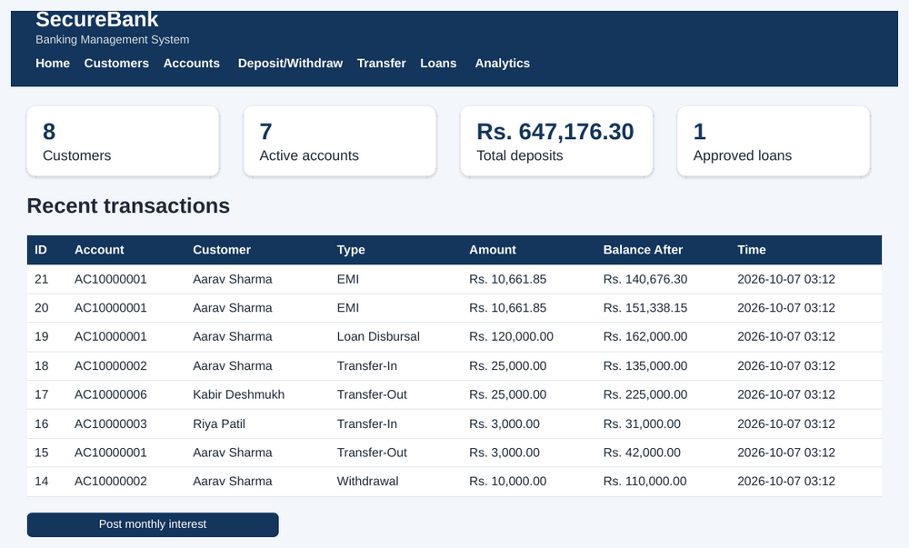
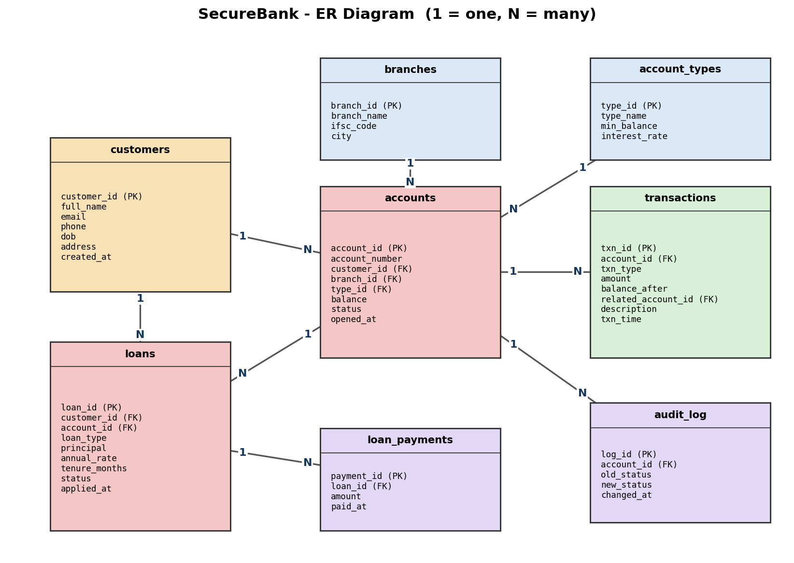
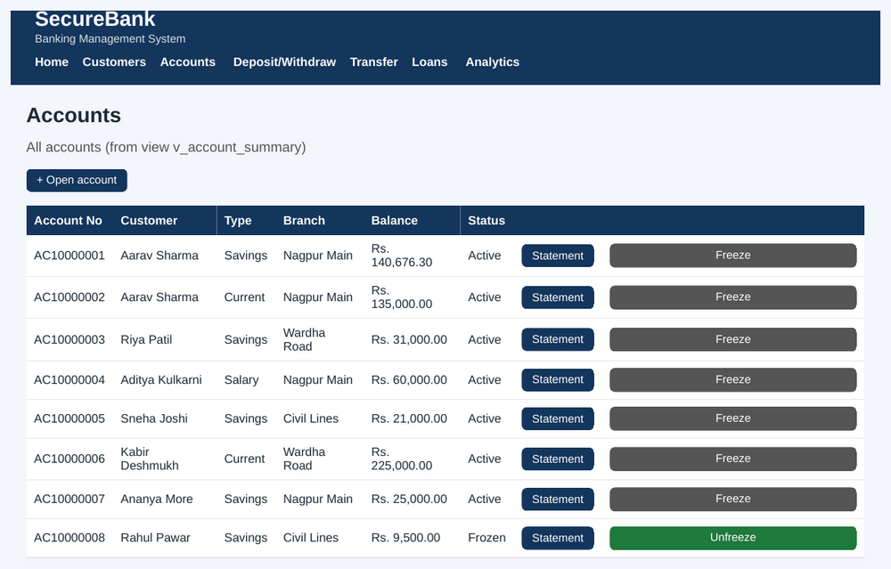
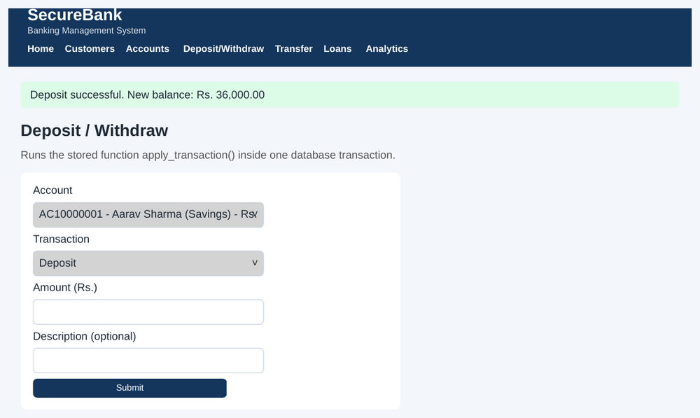
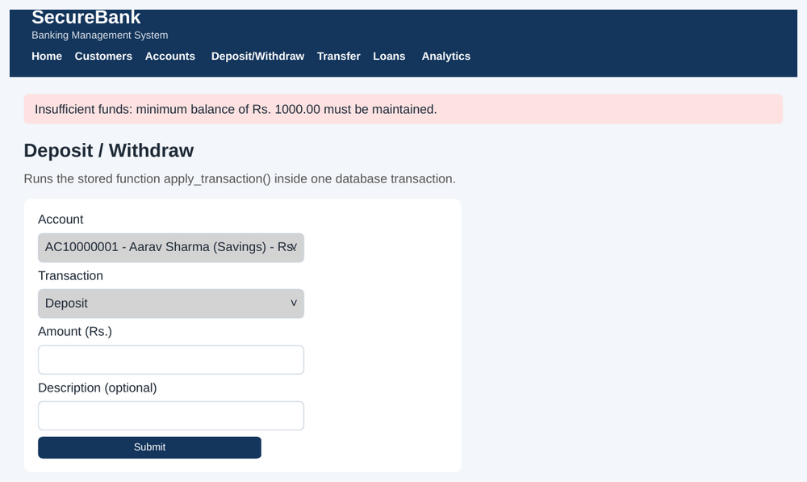
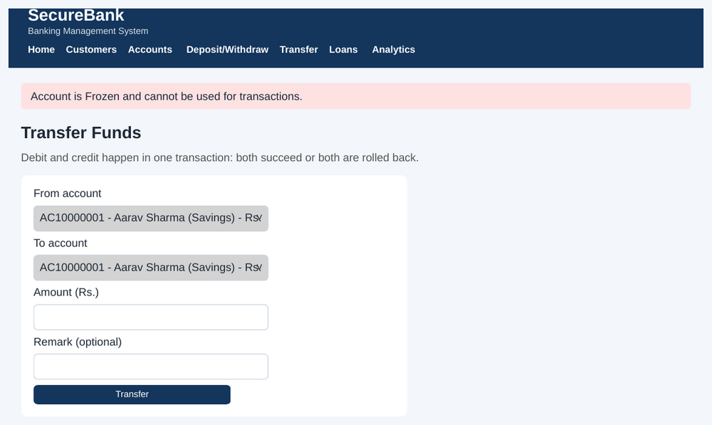
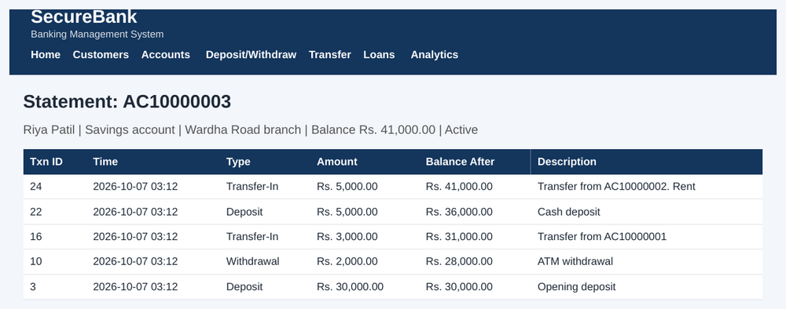
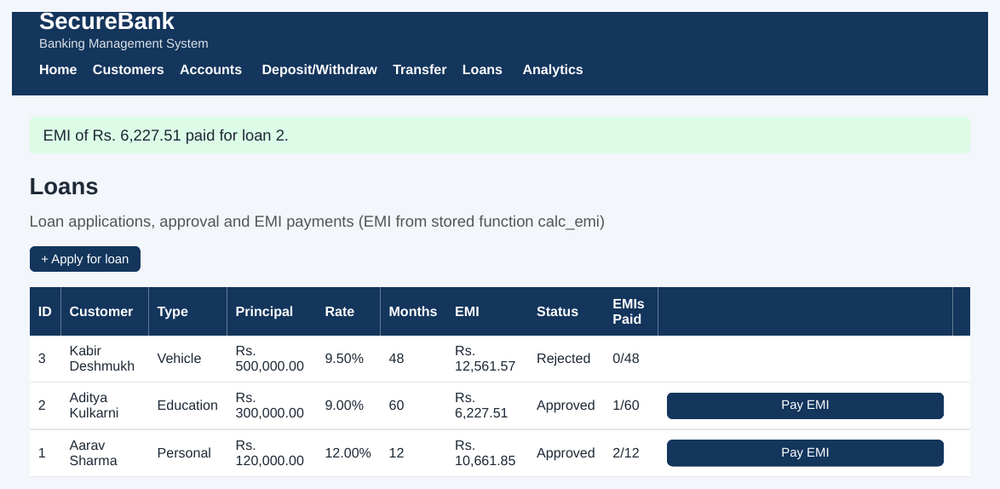
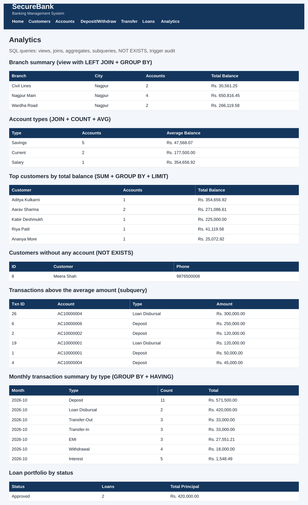

# SecureBank - Banking Management System

A DBMS mini project built with **Python, Flask and PostgreSQL**. It manages customers, accounts, deposits, withdrawals, transfers, loans with EMI, monthly interest and analytics - with the banking rules enforced **inside the database** (stored functions, trigger, constraints and atomic transactions).



## Features
- Add customers (age, phone and email validated by CHECK constraints)
- Open accounts with auto-generated numbers and a per-type minimum balance
- Deposit, withdraw and transfer money (a transfer is all-or-nothing)
- Freeze / unfreeze accounts (audit trail written by a trigger)
- Account statement for every account
- Loans: apply, approve / reject, pay EMI (EMI computed by a stored function)
- Post monthly interest to all eligible accounts
- Analytics page (views, joins, aggregates, subquery, NOT EXISTS)

## DBMS concepts demonstrated
| Concept | Where |
|---|---|
| 8 tables normalized to 3NF | `securebank.sql` |
| PK, FK, NOT NULL, UNIQUE, CHECK, DEFAULT, ON DELETE rules | `securebank.sql` |
| Sequence for account numbers | `account_no_seq` |
| Stored functions (PL/pgSQL) | `apply_transaction()`, `calc_emi()`, `post_monthly_interest()` |
| Trigger | `trg_account_status` -> `audit_log` |
| Views | `v_account_summary`, `v_branch_summary`, `v_loan_summary` |
| Indexes | on all foreign keys and `txn_time` |
| JOIN, GROUP BY / HAVING, subquery, NOT EXISTS | Analytics page, `queries.sql` |
| Transactions (COMMIT / ROLLBACK, `FOR UPDATE` row locks) | transfers, loan approval, EMI payment in `app.py` |

## ER diagram


## Screenshots
| | |
|---|---|
|  |  |
|  |  |
|  |  |
|  | |

## Setup
Requirements: Python 3.10+ and PostgreSQL (remember the password of the `postgres` user).
```bash
pip install -r requirements.txt
python setup_db.py      # creates user 'bank', database 'securebank', tables and sample data
python app.py           # open http://127.0.0.1:5000
```
`setup_db.py` asks for the `postgres` password. If your settings differ, set `DB_HOST`, `DB_PORT`, `DB_NAME`, `DB_USER`, `DB_PASSWORD`.

Manual alternative: create user `bank` (password `bank123`) and database `securebank`, then run `securebank.sql` and `sample_data.sql` in that order.

## Try the SQL yourself
Open `queries.sql` in pgAdmin or run `psql -U bank -d securebank -f queries.sql`. It includes a transfer that is rolled back so you can see atomicity.

## Tests
```bash
python -m unittest discover tests
```
11 integration tests (deposits, minimum balance, atomic transfer rollback, frozen accounts and the trigger, loan approval and EMI, EMI function, interest, constraints). They reload the schema and sample data, so use a development database.

## Project structure
```
app.py             Flask routes and transaction handling
setup_db.py        one-command database setup
securebank.sql     schema, functions, trigger, views
sample_data.sql    sample customers, accounts, transactions, loans
queries.sql        demo SQL queries
templates/ static/ web pages and styling
tests/             automated tests
docs/              project report (PDF)
screenshots/       images used in this README
```

## Limitations and future scope
No login or CSRF protection (academic demo) and the data is hypothetical. Ideas: authentication with roles, customer portal, scheduled interest, cards/UPI, PDF statements.

## License
MIT - see `LICENSE`.
